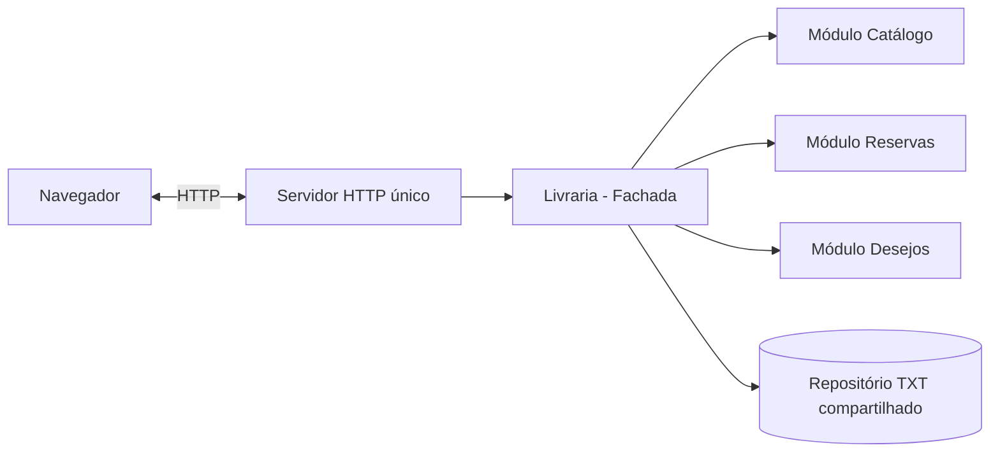

# Exercício 8.3 — Livraria com Arquitetura Monolítica Modular

Refatoração do MVP da livraria do **Exercício 7.4** para uma **arquitetura monolítica modular**.

## O que mudou?

O projeto continua sendo uma **única aplicação Python e um único servidor HTTP**, mas suas regras de negócio agora são divididas em módulos com responsabilidades claras:

- `modules/catalogo`: pesquisa, dados e disponibilidade dos livros.
- `modules/reservas`: criação, cancelamento e expiração de reservas por 24 horas.
- `modules/desejos`: inclusão e remoção de itens na lista de desejos.
- `application/use_cases.py`: orquestra os três módulos e preserva a interface que a aplicação já usava.
- `infrastructure/txt_repository.py`: mantém persistência compartilhada no arquivo `data/livraria.txt` (JSON em arquivo TXT).
- `presentation`: servidor HTTP e interface HTML, preservados do MVP.

A divisão foi feita por **funcionalidades de negócio**, inspirada no desenho de microsserviços, mas **sem separar processos, bancos ou servidores**. Isso caracteriza um monólito modular, não uma aplicação de microsserviços.

## Estrutura

```text
app.py
application/
    ports.py
    use_cases.py
modules/
    catalogo/
        models.py
        service.py
    reservas/
        models.py
        service.py
    desejos/
        service.py
infrastructure/
    txt_repository.py
presentation/
    http_server.py
    view.py
domain/
    entities.py             # compatibilidade com o exercício anterior
tests/
    test_livraria.py
```

## Execução

É necessário apenas **Python 3.10 ou superior**, sem bibliotecas externas:

```bash
python app.py
```

Abra `http://localhost:8000` no navegador. No GitHub Codespaces, abra a porta **8000** na aba **Ports**.

## Testes automáticos

```bash
python -m unittest discover -s tests -v
```

## Funcionalidades preservadas

Pesquisa por título ou autor; visualização de preço, estoque e estante; reserva por 24 horas; cancelamento; lista de desejos; persistência em TXT.

## Arquitetura (resumo)



**Entregável 8.3:** link do repositório com código refatorado. O deploy é pedido separadamente no exercício 8.4.
